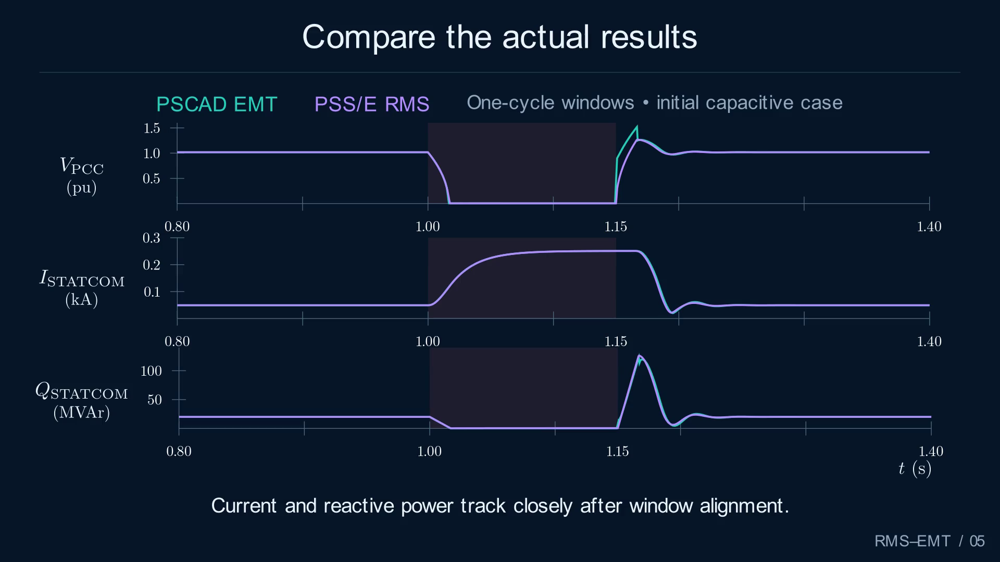

# Sequential RMS–EMT integration: narrated Manim film

A 116-second, 1920 × 1080, 30 fps film based on the actual licensed PSS/E
35.6.4 and PSCAD 5.1.0 runs in this project. English narration is AI-generated
using Microsoft `en-US-GuyNeural`, with a passionate voice profile, +5% rate
and +2 Hz pitch. English captions are supplied as SRT and an optional MP4 track.

The film covers a weak 230 kV grid, a nominal ±100 MVAr STATCOM, the transfer
of the solved PCC boundary and Thévenin impedance, and a 150 ms three-phase
fault. It shows the capacitive operating point (+20 MVAr initially). The
editable dataset also contains the actual inductive case (−20 MVAr initially).
All comparison curves are measured results. Only the introductory phasor and
sine-wave animation is conceptual, explicitly labeled on screen.

**Sequential, offline integration:** the simulations run independently after
the parameter handover. There is no real-time solver exchange or EMT feedback.
The matched terminal controllers are not identical transient models. The film
retains the material voltage difference at clearing and explains the network
energy and angle-tracking differences. See [model details](../docs/DYNAMIC_MODEL.md)
and [actual comparison tables](../docs/DYNAMIC_VALIDATION.md).

## Watch and download

[Published video and editable package](https://github.com/angelohafner/RMS-EMT-Integration/releases/tag/video-v1.0.0).
The release also supplies the original engineering package containing the native
simulation evidence. This source repository includes the compact plot data,
recorded speech, subtitles and circuit SVGs so that rendering requires neither
simulator nor a live speech service.



## Rebuild the film

Tested on Windows with Python 3.11, Manim 0.21.0, Schemdraw 0.23, FFmpeg 9.0,
TeX Live 2026 (`latex` and `dvisvgm`), and the Arial font. Install FFmpeg and
TeX Live separately and put their executables on PATH. The package versions
used for the video are pinned in `requirements.txt`.

Run these commands in PowerShell **from the project root**:

```powershell
py -3.11 -m venv video/.venv
video/.venv/Scripts/python.exe -m pip install -r video/requirements.txt
video/.venv/Scripts/python.exe -m manim -qh --fps 30 --media_dir video/media video/scenes.py RMSIntegrationFilm
video/.venv/Scripts/python.exe video/finalize.py
```

Alternatively, after installing the dependencies, run `video/build.ps1`.
The output is `video/output/RMS_EMT_Integration_EN_1080p.mp4`. Enable its English
subtitle track in a compatible player, or import `narration_en.srt` alongside it.
Subtitle support varies by player; captions are not burned into the picture.
No simulator or TTS connection is required for these rendering commands.

To change the speech, edit `script.json`, then run:

```powershell
video/.venv/Scripts/python.exe video/narrate.py
```

This optional step uses the online Microsoft Edge speech service through
`edge-tts`; it needs network access and service availability. Cached audio is
reused when the script/voice/rate/pitch hash matches. Word timestamps produce
the subtitles and scene durations. Keep the total duration between 90 and 120 s;
adjust scene cue times in `scenes.py` when substantially changing the script.
Service updates can change newly generated speech. Included MP3s preserve the
released narration, and no API credentials are bundled.

## Re-extract the engineering data

This optional step needs the original `runs/dynamic_capacitive_v2` and
`runs/dynamic_inductive_v2` directories. Download
`RMS_EMT_STATCOM_Dynamic_v2.zip` from the release and extract its `runs/`
directory into this project root. Preserve the checked-in video sources.
Install the engineering package into the same video environment, then run:

```powershell
video/.venv/Scripts/python.exe -m pip install -e .
video/.venv/Scripts/python.exe video/data_pipeline.py
```

The script verifies native run hashes, reads the actual processed CSVs, retains
minima and maxima while reducing display samples, and regenerates the Schemdraw
open/closed circuits. Missing runs or altered evidence raise errors; there is
no synthetic-results fallback. To run new simulations, follow the
[engineering instructions](../README.md). New runs must be revalidated and
their manifests deliberately updated before replacing the released plot data.

## Editable files

| File | Purpose |
|---|---|
| `scenes.py` | Six Manim chapters, MathTex equations and animation cues |
| `script.json`, `timeline.json` | English narration and audio-driven timing |
| `audio/*.mp3`, `audio/*.words.json` | Released speech and word timestamps |
| `narrate.py`, `narration_en.srt` | Optional speech regeneration and captions |
| `data_pipeline.py` | Native-data verification, display reduction, Schemdraw SVG |
| `assets/measurements.npz`, `assets/provenance.json` | Real curves and source hashes |
| `assets/circuit*.svg` | Schemdraw circuit states; labels are rendered with MathTex |
| `finalize.py` | Subtitle muxing, technical audit and review frames |
| `package.py` | Editable ZIP with audited movie and per-file hash verification |
| `audit.json`, `REVIEW.md` | Released technical checks and bounded review |

Real/imaginary parts use `\operatorname{Re}` and `\operatorname{Im}`. Electrical
variables, equations and units use MathTex. Plain English prose uses normal text.

The audit checks full-file decoding, resolution, frame rate, timing, audio level,
source-data hashes and preserved extrema. Review frames cover all six chapters.
Automated audio-level and timing checks do not certify subjective pronunciation
or listening quality. The narration files are included for direct listening.

To rebuild the editable ZIP after rendering, copy `video/output/audit.json` to
`video/audit.json` and run `video/.venv/Scripts/python.exe video/package.py`.
The archive includes the compact engineering manifest used by `finalize.py`;
it excludes the large native runs, which are supplied separately in the release.
